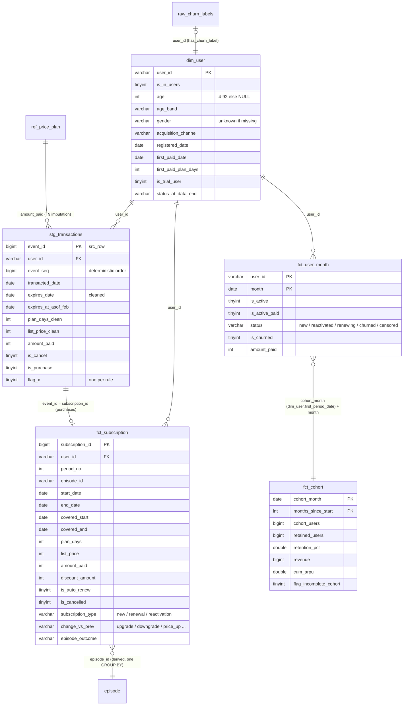

# Part 1b: Clean Layer and Data Model

Built by `sql/02_stg_transactions.sql` → `03_fct_subscription.sql` → `04_dim_user.sql` → `05_fct_user_month.sql` (→ `07_fct_cohort.sql`, a cohort roll-up of the panel), run in order by `run_all.py` from the raw CSVs in `data/` (the whole pipeline runs in about 20 s). Each script ends with a validation SELECT. Two consecutive runs give identical table fingerprints, so the build is deterministic. Issue codes (T4, T9, U11, L5 …) refer to `reports/01_data_quality.md`.

## Tables at a glance

| Table | Grain (one row = …) | Key | Rows | Purpose |
|:---:|:---:|:---:|:---:|:---:|
| ref_price_plan | one price | amount_paid | 47 | Price → plan-length lookup, used to fill in missing plan days (T9) |
| stg_transactions | one real billing event | event_id (= src_row) | 5,725,763 | Deduplicated, conflict-resolved events with typed dates and one flag per rule |
| fct_subscription | one subscription period (one purchase plus the cancels that follow it) | subscription_id (= src_row of the purchase) | 5,501,434 | Plan, price, discount, auto-renew, cancel, change vs previous, new/renewal/reactivation, episode |
| dim_user | one user seen anywhere | user_id | 1,800,905 | Cleaned attributes and derived fields |
| fct_user_month | one user × month with activity, payment or churn (Jan-2015 to Mar-2017) | (user_id, month) | 6,635,753 | Monthly panel: Part 2 metrics become GROUP BY month |
| fct_cohort | one start-month cohort × months since start (dense, zeros kept) | (cohort_month, months_since_start) | 378 | Cohort retention and revenue curves (retention %, ARPU, cumulative ARPU) |

## ERD

## Grain choices and why

**1. stg_transactions: one billing event, keyed by src_row.** (user_id, transacted_at) is not a key (T8): 46,658 user-days hold a cancel and a new plan, and stacked prepaid months (T24) share a day. Collapsing to one row per user-day would turn plan switches into cancellations and erase prepaid revenue. Keeping the event grain plus a deterministic `event_seq` keeps every real event and fixes their order.

**2. fct_subscription: one row per subscription period (purchase), with an episode_id.** Considered:

| Option | One row = | Keeps the plan sold (Q3/Q4) | Revenue sums exactly | Churn / reactivation | Verdict |
|:---:|:---:|:---:|:---:|:---:|:---:|
| A: Episode | one continuous membership | No: a 30-day → annual switch is averaged away | Yes | Natural | Kept as a derived level (episode_id) |
| B: Period (purchase) + episode_id | one purchase and its cancels | Yes | Yes (reconciles to 0) | One GROUP BY on episode_id | **Chosen** |
| C: User-day | one day of access | No | Only by allocation | Natural | Too big; no plan detail |

The period is the unit the business sells and prices, so discount, plan length, auto-renew and upgrade/downgrade live naturally on it. Episodes are what churn is about, so every period carries `episode_id`, `episode_start_date`, `episode_end_date` and `episode_outcome`.

**3. fct_user_month: sparse user × month panel.** A row exists only when the user had access on at least one day, paid, or churned that month. A dense grid of 605,802 transacting users × 27 months would be about 16M rows, mostly zeros that every metric filters out anyway.

**4. dim_user: every user seen anywhere.** 109,330 transacting users (18%) are missing from users.csv (T23), and labelled users missing from it churn at 5.2% vs 9.4% (L5). An inner join would drop a lower-churn group and bias the churn drivers. They stay, with `is_in_users = 0` and 'Unknown' attributes.

**5. fct_cohort: one row per start-month cohort × months since start.** Built in `sql/07_fct_cohort.sql` from `dim_user` and `fct_user_month`. The cohort is the month of the user's **first subscription period** (`dim_user.first_period_date`, free or paid), not the registration date in users.csv: registration is missing for 109,330 transacting users (T23), falls before the data starts (2015-01) for 44% of the rest, and is sometimes after the first purchase (U8). The grid is dense (every month from the start month to 2017-03), so a cohort that fades out shows 0 rather than a missing row. 27 cohorts, 378 rows, 600,667 users (every user with at least one subscription period).

| Field | Definition |
|:---:|:---:|
| cohort_month | Month of the user's first subscription period |
| months_since_start | 0 = start month, 1 = next calendar month, … |
| calendar_month | cohort_month + months_since_start |
| cohort_users | Users who started in cohort_month |
| active_users | Cohort users with access on ≥ 1 day of the month (`fct_user_month.is_active`) |
| retained_users | Cohort users active in the month **or** who bought in it. Same as active_users except purchases with 0 access days (3,454 users in their start month), so month 0 = 100% |
| retention_pct | retained_users / cohort_users × 100 |
| active_paid_users | Cohort users with access from a paid period (`is_active_paid`; excludes free trials, includes annual payers in months they did not pay) |
| paying_users | Cohort users who paid money in the month (amount_paid > 0) |
| revenue | amount_paid of purchases made in the month (cash view: an annual plan counts fully in its purchase month) |
| cum_revenue | revenue from month 0 to this month |
| arpu | revenue / cohort_users (per user who started, so cohorts compare fairly) |
| cum_arpu | cum_revenue / cohort_users: revenue per starting user to date; its growth over the months is the cohort's revenue curve |
| arpu_active | revenue / active_users |
| months_observed | Months of data the cohort has (cohort_month to 2017-03) |
| is_last_observed_month | 1 on the 2017-03 row |
| flag_incomplete_cohort | 1 for cohorts from 2016-10 on (fewer than 6 months of data; 6 cohorts) |
| flag_left_censored | 1 for the 2015-01 cohort: partly older users first seen when the data starts |

## How periods, coverage and episodes are built

The key fact about this billing system: **`expires_at` is the membership expiry after the event, not the plan's own end.** An early renewal stacks its days on top of the old expiry. Of 1,047,912 early 30-day renewals, 1,003,292 expire about 30 days after the *previous* expiry, not after the purchase date. So:

| Column | Rule |
|:---:|:---:|
| start_date | Purchase date |
| end_date | Membership expiry after the last event of the period: the purchase, or a cancel that follows it (cancels can move expiry earlier, T15). Floored at start_date |
| covered_start, covered_end | The stretch of time this period "owns": from its purchase until the next purchase takes over, or its end_date. Intervals never overlap within a user (validated: 0 overlaps), so active days and active users add up safely |
| gap_days | start_date − previous period's end_date. Negative = renewed early |
| episode | A new episode starts when gap_days > 30, the brief's churn window. A user who buys again within 30 days of expiry stays in the same episode, so episodes and the churn labels follow the same rule by design |
| subscription_type | new = the user's first period; reactivation = the first period of a later episode; renewal = everything else |
| change_vs_prev | Compared with the user's previous period: free_to_paid, paid_to_free, upgrade/downgrade (plan tier changes), price_up/price_down (same tier, different list price), same |
| plan_tier | 1 trial/weekly (≤10 d), 2 monthly (11-45 d), 3 multi-month (46-300 d), 4 annual (>300 d). 30 vs 31 days is the same monthly product; comparing raw days made 51,028 "31 → 30" rows look like downgrades |
| episode_outcome | active_at_data_end (expiry after 2017-03-31); churned_then_reactivated; churned (no purchase within 30 days, window fully observed); censored (window runs past 2017-03-31, outcome unknown) |

`fct_user_month.status` per row, in order of precedence: **new** (first episode starts this month), **reactivated** (a later episode starts), **churned** (an episode's expiry date falls in this month and no purchase followed within 30 days), **censored** (same, but the 30-day window runs past the data end: every March-2017 expiry except 03-01), **renewing** (active, carried over from an existing episode). `is_churned` is also a separate flag, because a user can start and churn in the same month.

## Cleaning rules

| # | Rule | Issue | Rows affected | Where |
|:---:|:---:|:---:|:---:|:---:|
| 1 | Union both exports; they are split on expiry, not on date. Keep src_file / src_row for lineage | T1-T3 | 89,728 old purchases live only in export_2 | 00, 02 |
| 2 | Drop exact copies of a whole row inside one export; keep the lowest src_row | T7 | 832 removed | 02 |
| 3 | Same event in both exports (one-to-one match on user, day, method, plan, amount, cancel): export_2 wins; the export_1 expiry is kept as `expires_at_asof_feb` | T4 | 747 export_1 rows removed, `flag_conflict_resolved` | 02 |
| 4 | Different events on the same user and day are all kept (no dedup on user + day) | T6, T8 | `flag_same_day_multi`, `flag_same_day_both_exports` | 02 |
| 5 | Stacked purchases (same purchase repeated on one day, each extending expiry) are kept as separate purchases; the period end is the latest expiry | T24 | 36,452 rows, `flag_stacked` | 02, 03 |
| 6 | Same-day order (`event_seq`): cancel first, then purchases, then expiry ascending, then src_row. The "last event of the day" is the purchase with the latest expiry. Without a full tie-break key, a churn count moved between runs (28,506 vs 28,322) | T8 | All users | 02 |
| 7 | Exception to rule 6: a cancel on the user's first purchase day has no earlier plan to cancel, so it applies to that purchase | T8 | 5,866 cancels (4,761 bought and cancelled on the same day) | 03 |
| 8 | Missing plan days and list price on paid rows (Mar-Oct 2015): plan days from the price lookup (a price counts only if one plan covers ≥ 90% of its rows, e.g. 149 → 30 d at 94%, 1,788 → 410 d at 98%); snapped date span as fallback; list_price = amount_paid (discount 0) | T9 | 214,188 rows: 213,935 by price, 253 by dates, 0 unresolved | 02 |
| 9 | Free rows are kept: `is_free = 1`, `price_type` = free_trial_discount (list > 0) or free_unpriced (list = 0). Every metric can split paid vs free | T11, T12 | 79,575 + 163,152 | 02 |
| 10 | Zero-plan-day rows that are not T9 create no subscription period (kept in stg) | T13 | 3,204 | 02, 03 |
| 11 | Cancel: the cancel row's expiry becomes the period's end date, floored at its start; `is_cancelled = 1`. A cancel with the 1970 placeholder ends on its own date | T14, T15 | 213,766 periods cancelled | 02, 03 |
| 12 | Cancels with no earlier purchase (plans bought before 2015 that we never see) are orphans and change nothing | T14 | 7,415 | 03 |
| 13 | Non-cancel expiry missing (1970-01-01) or before the purchase: expiry = purchase date + plan days | T16, T17, T18 | 1,691 rows, `flag_expiry_epoch`, `flag_expiry_before_tx` | 02 |
| 14 | Expiry more than 2 years past the data end: kept and flagged (mostly long stacks) | T19 | 1,738 | 02 |
| 15 | Paid above list price: discount floored at 0, flagged | T10 | 13 | 02 |
| 16 | Revenue = amount_paid on purchases only. Cancel rows carry an amount (160,720 rows, 23.2M) that is the cancelled plan's price, not a payment; kept in stg for audit | — | — | 03 |
| 17 | Age outside 4-92 → NULL; age_band includes 'Unknown'. No imputation | U1-U4, U11 | 1,136,998 | 04 |
| 18 | Gender missing → 'unknown', its own segment | U5 | 1,106,850 | 04 |
| 19 | Registration after the data end or after the first transaction: kept and flagged; tenure starts at the earlier of registration and first transaction | U7, U8 | 13,756 + 26 | 04 |
| 20 | Left-censoring: data starts 2015-01-01, so the 133,585 users first seen in Jan 2015 may have subscribed earlier. Their "new" is flagged (`flag_first_seen_jan2015`); Jan-2015 new counts must not be read as acquisition | — | 133,585 | 04 |

### Change from the Part 1a decision (T9)

1a chose "plan days from the row's own dates, price lookup as fallback". Building the periods showed why that is wrong: because expires_at is the membership expiry, an early renewal carries the old remaining days. Among T9 rows, 149-paid rows (a 30-day price) spanning about 400 days are 30-day renewals on top of an existing expiry, not annual plans. So 1b flips the order: price lookup first (94-100% reliable for the prices that matter), date span only where the price has no dominant plan (253 rows).

## Validation results (from the scripts)

| Check | Result |
|:---:|:---:|
| stg rows = raw − exact copies − superseded export_1 rows | 5,727,342 − 832 − 747 = 5,725,763 ✓ |
| event_id unique; (user_id, event_seq) unique | 0 duplicates ✓ |
| Non-cancel expiry before purchase after cleaning | 0 ✓ |
| One period per purchase; subscription_id and (user_id, period_no) unique | 5,501,434 = 5,501,434; 0 duplicates ✓ |
| Covered intervals overlap within a user | 0 ✓ |
| Revenue: fct_subscription vs stg purchases vs fct_user_month | Difference 0 and 0 ✓ |
| dim_user covers every registry, transaction and label user | 0 missing ✓ |
| (user_id, month) unique; 27 months; active days ≤ 31 | ✓ |
| Reactivations in fct_user_month = later episodes in fct_subscription | 147,477 = 748,144 − 600,667 ✓ |
| fct_cohort: cohort sizes = users with a subscription in dim_user | 600,667, difference 0 ✓ |
| fct_cohort: revenue and final cum_revenue = fct_user_month = fct_subscription | Difference 0 ✓ |
| fct_cohort: active, active-paid and paying users = fct_user_month counts | Difference 0 ✓ |
| fct_cohort: month-0 retention; values in range | 100% for all 27 cohorts; no value < 0 or > 100%; cum_arpu never falls ✓ |
| Two full runs give identical table fingerprints | ✓ |

## Critique of the alternative star schema (dim_users / fct_transactions / fct_subscriptions)

A second-opinion model (Gemini) proposed a classic star: `dim_users`, `fct_transactions` and `fct_subscriptions`. The shape is close to this one; the problems are in the details that decide the answers.

| Point | Alternative | This model | Why it matters |
|:---:|:---:|:---:|:---:|
| User dimension | dim_users from users.csv | dim_user from every user_id seen anywhere, with `is_in_users` | The registry misses 18% of transacting users, who churn less (L5). Starting from users.csv drops them from any join |
| Transaction dedup | One row per (user_id, transaction_date): sum paid, max expiry, cancel wins | Event grain; remove exact copies and cross-export versions only | User-day merge turns 46,658 plan switches into cancellations and collapses stacked prepaid months worth about 5M |
| Cancels | Period ends on the cancel date | Period ends at the cancel row's expiry (the brief's definition) | Cutting at the cancel date removes a median 11 days of access on 66,236 cancels, so actives drop and churn looks earlier |
| Subscription dates | end = expires_at, start = transaction date, periods overlap | end = membership expiry, plus non-overlapping covered intervals | expires_at is cumulative. Without covered intervals, an early renewal is counted twice for those days, inflating actives |
| Episodes and churn | Not defined in the schema | episode_id with the 30-day gap rule, outcome incl. censored | Part 1c and Part 2 churn need it; the same rule as the labels avoids a second churn definition |
| Monthly metrics | Computed ad hoc from fct_subscriptions | fct_user_month panel with status and flags | Part 2 metrics become one GROUP BY, and new/renewing/reactivated/churned are defined once |
| Determinism | Not addressed | Full tie-break key (`event_seq`) | Same-day ties changed a churn count between runs |

What the star does better: fewer tables and a familiar shape for BI tools. Our `fct_user_month` and `ref_price_plan` add surface area. The trade-off is worth it here because the hard part of this dataset is the event logic, not the joins.

## Known limits

- The same-day order (cancel before purchase) is a rule, not a fact: the files have no timestamp or event ID. It is documented, deterministic and has one data-driven exception (rule 7).
- T16/T17 derived expiries use purchase date + plan days. For an early renewal the true expiry would be later; this affects 1,691 rows.
- March-2017 churn is censored by construction (the 30-day window needs April data). Billing's labels use April data we don't have; Part 1c deals with that.
- Cancel-row amounts (rule 16) are interpreted, not documented. If billing confirms they are refunds, revenue needs a negative adjustment.
